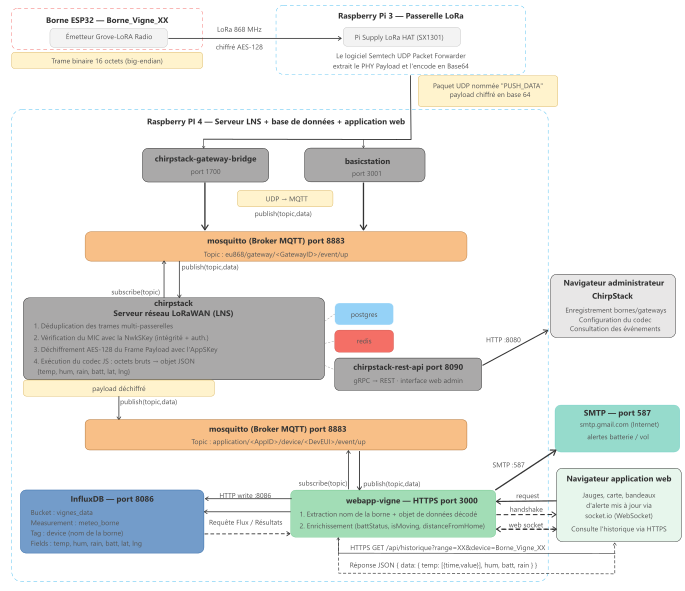
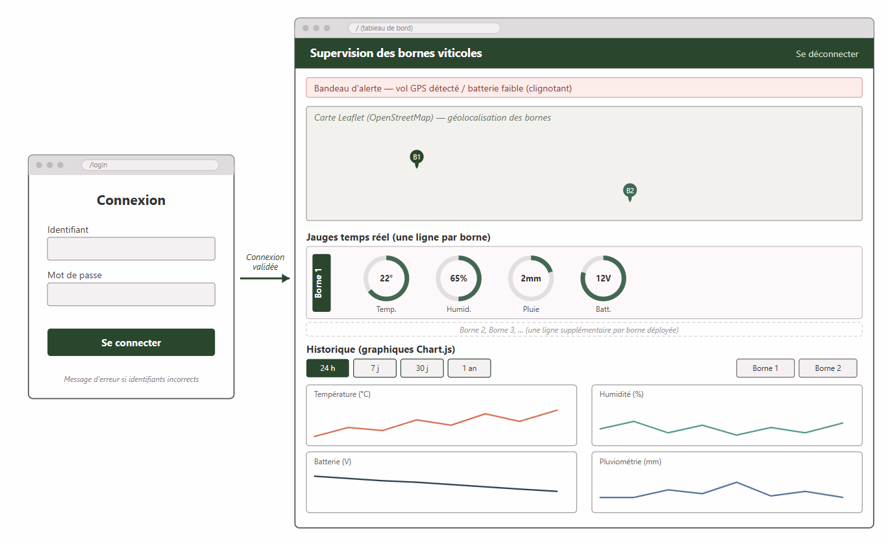
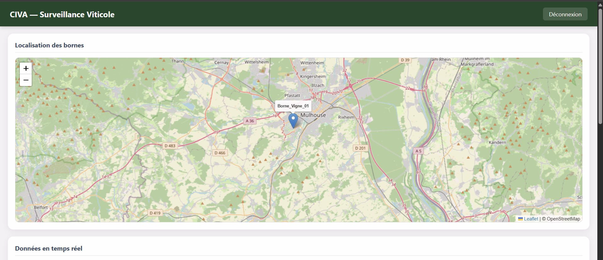
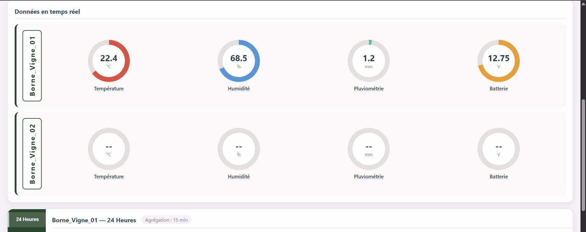
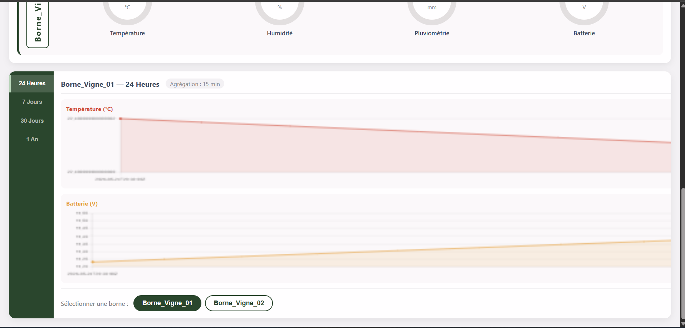
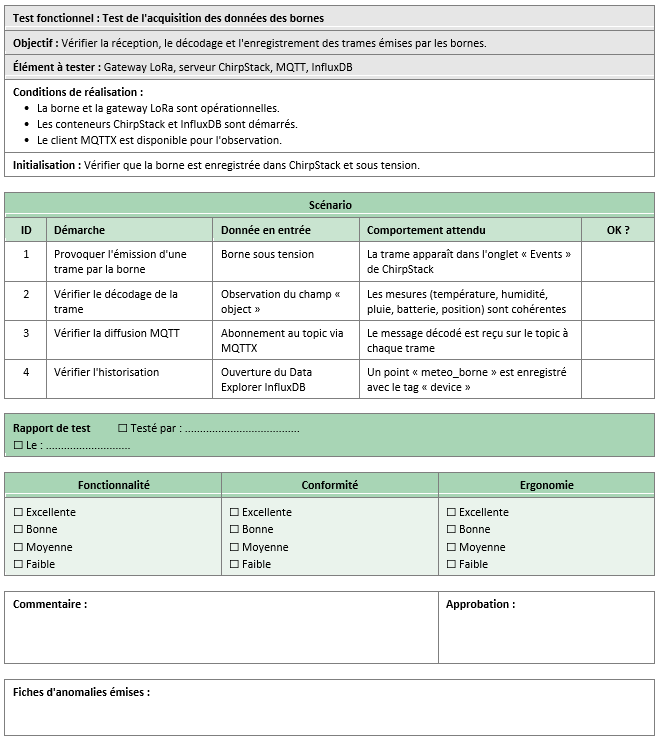
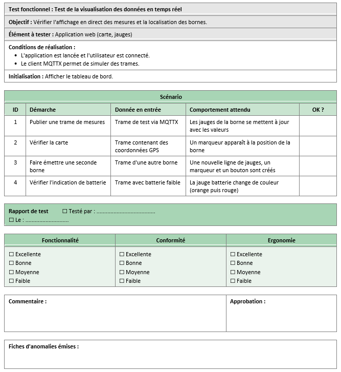
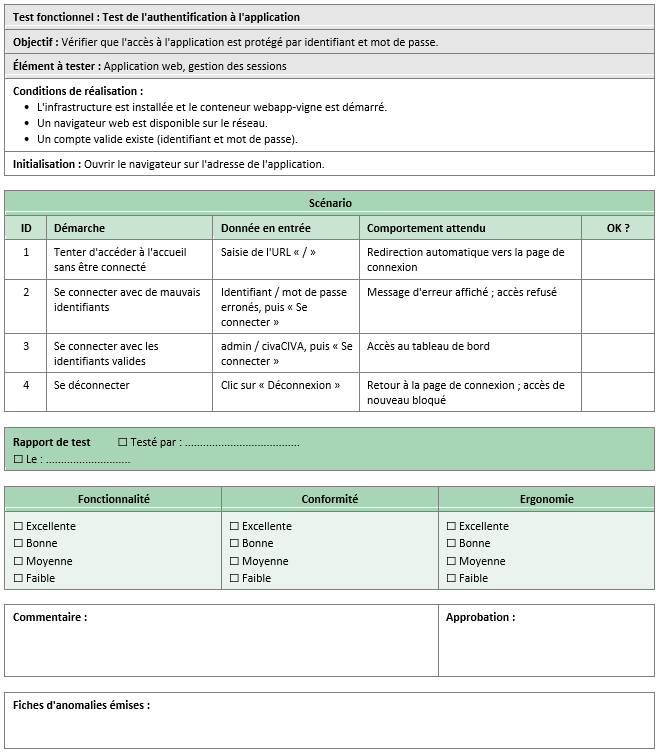
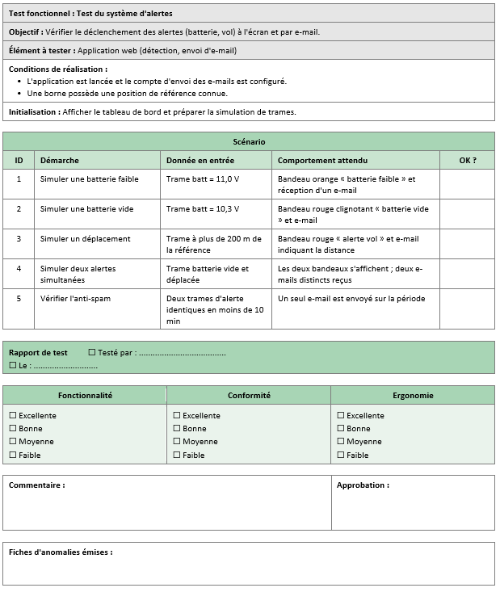
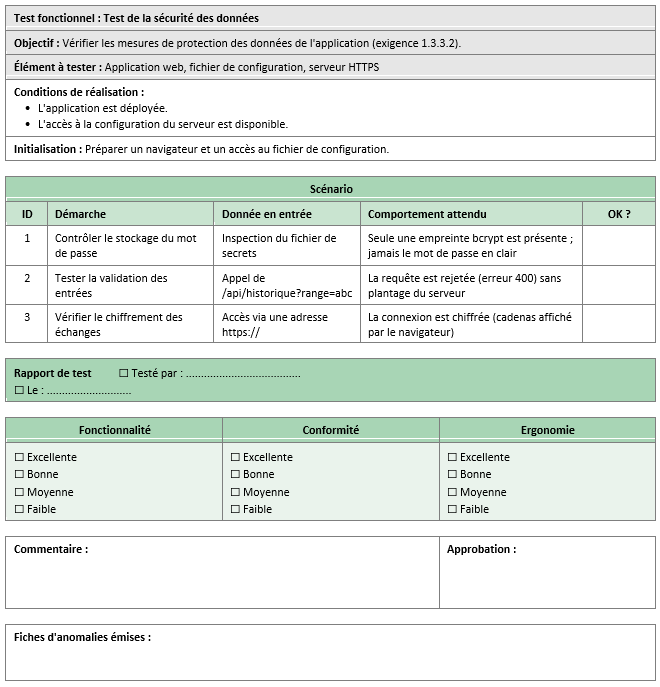

# 🍇 Borne de Télémesure Viticole — CIVA Monitoring

**Station IoT LoRaWAN de suivi climatique des vignes alsaciennes**, de la mesure sur le terrain jusqu'à la supervision web en temps réel.

> 🎓 Projet de fin d'études **BTS CIEL** (Lycée Louis Armand, Mulhouse — promotion 2026), réalisé avec le **CIVA** (Conseil Interprofessionnel des Vins d'Alsace) comme partenaire industriel. Projet pédagogique, sans contrat commercial.

## 🎯 Le besoin

Le CIVA exploite un parc de bornes de télémesure en Centre Alsace pour étudier les effets du réchauffement climatique sur les vignes. La solution existante, gérée par un prestataire privé, cumule trois contraintes : un coût d'environ **500 € par borne**, un **abonnement 4G par carte SIM** pour chaque unité, et des données envoyées vers un **serveur externe non maîtrisé**.

L'objectif du projet : concevoir une alternative souveraine et économique — davantage de bornes, **zéro abonnement**, données hébergées sur un **serveur privé local**, stack **100 % open-source**.

| | Résultat |
| --- | --- |
| 💶 Coût matériel du serveur complet | **113 €** (Raspberry Pi 4) |
| 💶 Coût d'une borne de télémesure | **245 €** (Raspberry Pi 4) |
| 📡 Abonnements / dépendances cloud | **0 €** |
| 🔑 Licences logicielles | **0 €** (tout open-source) |
| 🐳 Conteneurs Docker orchestrés | **6** sur un seul Raspberry Pi 4 |

## 🏗️ Architecture

**Le trajet d'une mesure :**

1. **Borne viticole (ESP32)** — capteurs DHT22 (température/humidité), GPS NEO-6M, pluviomètre à augets, alimentation batterie + panneau solaire. Les mesures sont encodées sur 16 octets et émises en **LoRa 868 MHz** (classe A, activation OTAA — la plus économe en énergie).
2. **Passerelle LoRaWAN (Raspberry Pi 3 + concentrateur RAK2245)** — relaie les trames vers le serveur (UDP 1700).
3. **Serveur (Raspberry Pi 4, Docker Compose)** — **ChirpStack v4** (serveur LoRaWAN : Gateway Bridge, Application Server, PostgreSQL, Redis) décode la charge utile via un codec JavaScript maison, publie sur le broker MQTT **Mosquitto**, et historise automatiquement dans **InfluxDB v2** (bucket dédié, token à permissions restreintes).
4. **Application web Node.js** — s'abonne au broker en MQTT (joker `+` : toute borne présente ou future est captée sans modification du code) et pousse chaque trame vers les navigateurs connectés via **Socket.io**, sans rechargement de page.

L'infrastructure complète se lance avec une seule commande : `docker compose up`.

## ✨ Fonctionnalités de l'application web

| | |
| --- | --- |
| 🗺️ **Carte Leaflet** | Position temps réel de chaque borne sur le vignoble |
| 📟 **Jauges circulaires** | Température, humidité, batterie, pluviométrie — mises à jour en direct |
| 📈 **Historique Chart.js** | 4 plages (24 h, 7 j, 30 j, 1 an) servies par une API avec agrégation `aggregateWindow` : seules les moyennes transitent, jamais des milliers de points bruts |
| 🚨 **Alerte antivol** | Formule de **Haversine** : déplacement > 200 m par rapport à la position de référence → alerte rouge clignotante + email |
| 🔋 **Alerte batterie** | Seuil orange à 11,5 V, rouge critique à 10,5 V, notification par Nodemailer (SMTP, mot de passe d'application révocable) |
| 🔐 **Authentification** | Sessions `express-session` (cookie signé, durée 8 h), mots de passe hachés **bcrypt**, middleware `requireAuth` sur toutes les routes sensibles |
| 📡 **Multi-bornes natif** | Registre dynamique côté serveur + interface auto-adaptative : une borne inconnue qui émet crée automatiquement ses jauges, son marqueur et son bouton de sélection |

  

  &nbsp;
  &nbsp;
  &nbsp;

## 🔒 Sécurité

- **TLS de bout en bout** : HTTPS pour l'application web et **MQTTS** pour le transport des trames, avec une autorité de certification auto-signée générée pour le projet
- **Secrets hors du code** : identifiants, tokens et clés isolés dans un fichier `.env` exclu du versionnage
- **Moindre privilège** : le token InfluxDB n'a que les droits lecture/écriture sur le bucket `vignes_data`
- **Entrées validées** : whitelist + regex sur les paramètres de l'API historique contre les injections de requêtes Flux
- **Chiffrement LoRaWAN** : authentification des bornes par OTAA (DevEUI / JoinEUI / AppKey)

## 🧩 Défis techniques résolus

Quelques problèmes réels rencontrés et leurs solutions — souvent plus instructifs que les fonctionnalités elles-mêmes :

- **Hash bcrypt tronqué dans Docker Compose** : les caractères `$` du hash étaient interprétés comme des variables d'environnement par Compose. Solution : échappement en `$$` dans le YAML.
- **Double connexion MQTT de ChirpStack v4** : la v4 sépare l'intégration applicative du backend de passerelle par région. Il a fallu configurer les deux connexions et restreindre `enabled_regions` à `["eu868"]`.
- **Température négative en LoRa** : la charge utile transporte des octets non signés ; le codec reconstitue les valeurs signées par complément à deux sur 16 bits.
- **Volumétrie de l'historique** : renvoyer un an de mesures brutes saturait le navigateur. L'agrégation par fenêtres côté InfluxDB (moyennes) a réglé le problème.

## ✅ Validation

Le système a été validé par des **cahiers de recettes** formel : tests d'acceptation couvrant la chaîne complète (réception LoRa, décodage, historisation, temps réel, alertes, authentification), chacun avec procédure d'exécution et résultat attendu mesurable.

## 🛠️ Stack technique

**Embarqué & radio** : ESP32 · LoRa/LoRaWAN 868 MHz (OTAA, classe A) · DHT22 · GPS NEO-6M · RAK2245
**Serveur** : Raspberry Pi 4 · Raspberry Pi OS Lite (Debian, ARM64) · Docker & Docker Compose · ChirpStack v4 · Mosquitto · InfluxDB v2 · PostgreSQL · Redis
**Application web** : Node.js · Express · Socket.io · MQTT.js · Leaflet · Chart.js · bcrypt · express-session · Nodemailer · @influxdata/influxdb-client
**Sécurité** : TLS (HTTPS / MQTTS) · CA auto-signée · OTAA LoRaWAN

## 👤 Auteur

**Ilies Boussaboua** — BTS CIEL, Lycée Louis Armand (Mulhouse) 
Partie individuelle présentée ici : serveur LoRaWAN, base de données, application web et sécurisation. La borne ESP32 et la passerelle ont été réalisées par mes binômes dans le cadre du projet commun.

[LinkedIn](https://www.linkedin.com/in/ilies-boussaboua) · bouss.ilies@gmail.com
